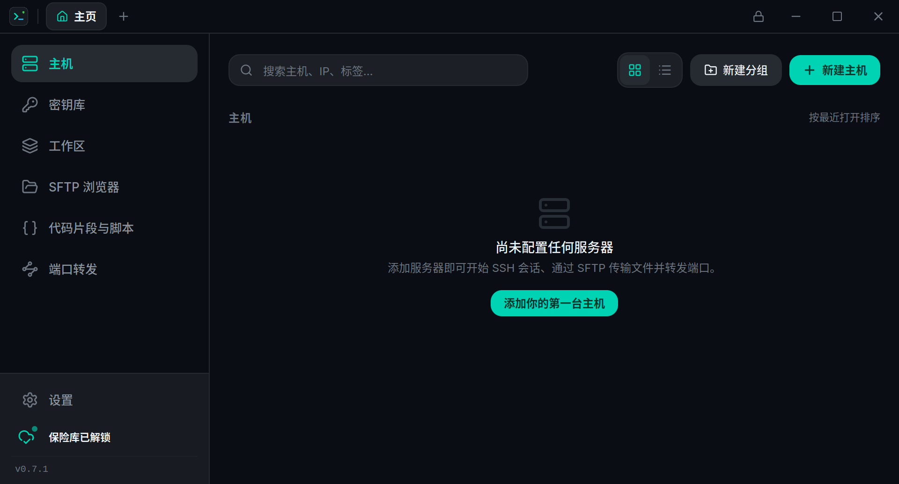

<p align="center">
  
</p>

<h1 align="center">Termimus</h1>

<p align="center">
  <strong>本地优先、零知识的 SSH 客户端与服务器管理套件</strong><br>
  面向 Linux、macOS 和 Windows 的现代自托管 Termius 替代品 · <strong>v0.7.0</strong>
</p>

<p align="center">
  <a href="https://github.com/termimus/termimus-ssh/releases"></a>
  <a href="https://ko-fi.com/termimus"></a>
  <a href="https://github.com/termimus/termimus-ssh/blob/main/LICENSE"></a>
  <a href="https://github.com/termimus/termimus-ssh/pkgs/container/termimus-sync"></a>
  
  
  
  
</p>

<p align="center">
  
</p>

---

## ⚡ 什么是 Termimus？

**Termimus** 是一款开源的桌面 SSH 管理器和终端套件，专为拒绝将生产凭据存储在第三方专有云中的工程师、系统管理员和 DevOps 团队打造。

与强制注册云账户的 SaaS 替代品不同，Termimus 是**本地优先**的：你的数据库通过嵌入式 SQLite 实现 100% 离线运行，你的私钥和密码永远不会未加密地离开你的机器。当你需要多设备同步时，Termimus 会使用端到端零知识加密连接到你自己托管的 **Go 同步中继服务器** —— 服务器只是一个无法解密你数据的盲中继。

---

## 📥 下载

每个版本的预构建安装包都会自动发布到 **[GitHub Releases](https://github.com/termimus/termimus-ssh/releases/latest)** 页面 —— 无需任何构建工具。

| 平台 | 安装包 | 说明 |
|---|---|---|
| 🐧 Linux | `.deb` / `.AppImage` | Debian/Ubuntu 软件包或便携式 AppImage（适用于任意发行版） |
| 🍎 macOS | `.dmg` | 通用二进制 —— 在 Intel 和 Apple Silicon 上均可原生运行 |
| 🪟 Windows | `.msi` / `.exe` | MSI 安装程序或 NSIS 安装可执行文件 |

> 更希望从源码构建，或想参与贡献？请参阅下方的[快速上手](#-快速上手)。

---

## ✨ 功能一览

### 🖥️ 原生终端体验
- **异步 Rust SSH 引擎**：由 `russh` 和 `@xterm/xterm` 6 驱动的多标签页终端。
- **分屏窗格与动态布局**：可在任意方向拆分终端，支持可拖拽的分隔条、标签页拖放，以及标签自动分组（`Web Server (2)`）。
- **终端互联与输入广播**：一键在所有分屏窗格间同步输入（`SYNC` 开关 / `Alt+B`），将按键和命令同时广播到多台服务器。
- **会话几何保护**：后台标签页保持挂载而不会坍缩为 0×0 几何，防止远程 `htop`、`vim` 和 curses TUI 因虚假的 SIGWINCH 事件而损坏。
- **快速连接**：随时可通过 `Ctrl+K` 唤起的即时模糊搜索启动器。

### 🗂️ 工作区与多服务器集群启动器
- **多服务器布局预设**：设计并保存复杂的多终端分屏布局（单窗格、左右二分、上下二分、三向、四宫格、六宫格矩阵），并为每个窗格分配主机。
- **一键集群启动器**：原子化的多会话启动器可同时连接所有目标机器，并将它们排列到预先配置的分屏窗格中，零布局抖动。
- **交互式蓝图设计器**：可视化布局设计器，用于预览蓝图、为主机分配窗格，并自定义工作区标签和颜色。
- **将当前分屏保存为预设**：一键将当前实时的分屏布局和已打开的 SSH 会话快照为可复用的工作区预设。

### 📂 双栏 SFTP 与内置代码编辑器
- **无缝传输**：本地 ↔ 远程双栏浏览器，点击即可快速传输导航。
- **远程直接编辑**：通过 SFTP 直接查看和编辑配置文件，支持语法高亮和快捷键保存（`Ctrl+S`）。

### 🔑 密钥库与身份管理
- **私钥保险库与导入**：安全存储和整理 SSH 私钥（OpenSSH、PEM、PuTTY）。可直接从本地密钥文件导入或粘贴 PEM 文本。
- **即时公钥派生**：从导入的私钥自动派生 OpenSSH 公钥行（`ssh-ed25519`、`ssh-rsa`、`ecdsa`）和 SHA256 指纹，以便粘贴到远程 `authorized_keys`。
- **私钥查看与复制**：在保险库解锁时按需安全查看或复制解密后的私钥，受隐私模糊保护。
- **密码身份**：存储可复用的用户名与密码组合，以便跨多台主机分配而无需重复输入。

### 🌐 端口转发与 SSH 隧道
- **多种隧道类型**：支持本地（`-L`）、远程（`-R`）和动态 SOCKS5（`-D`）端口转发。
- **实时状态开关**：通过实时活动指示器监控和管理转发规则。

### 📜 代码片段与脚本
- **即时脚本运行器**：存储常用的 Shell 脚本、部署命令和系统诊断命令。
- **活动标签页注入**：一键将代码片段直接发送到你正在运行的终端会话。

### 🔒 企业级本地安全
- **零知识保险库**：所有密码和密钥均使用由 **Argon2id** 派生的密钥通过 **AES-256-GCM** 进行静态加密。
- **操作系统密钥环集成**：可选地在启动时使用桌面安全凭据存储静默自动解锁（Linux 上的 **KWallet / GNOME Secret Service**、**macOS Keychain** 或 **Windows Credential Manager**）。
- **可配置的自动锁定**：在闲置 15 分钟 / 1 小时或窗口失去焦点时自动锁定保险库并清零内存。
- **TOFU 主机密钥验证**：首次使用信任（Trust-On-First-Use）的主机密钥指纹，在 SSH、SFTP 和隧道上对密钥不匹配进行硬拒绝，以防范中间人（MITM）攻击。

### ☁️ 自托管多设备同步
- **零知识中继**：使用 Docker 自托管我们超轻量的 Go 同步服务器（`server/`）。
- **实时 WebSocket 同步**：当另一台机器发生更改时，已连接设备会收到即时推送通知。
- **安全合并**：同步合并传入更新时不会覆盖本地已信任的服务器指纹。

---

## 🏛️ 架构

```
┌─────────────────────────────────┐               ┌─────────────────────────────────┐
│     Termimus（工作笔记本）        │               │      Termimus（家用桌面）        │
│  - Tauri v2 + Rust + React 19   │               │  - Tauri v2 + Rust + React 19   │
│  - 本地 SQLite（termimus.db）    │               │  - 本地 SQLite（termimus.db）    │
│  - AES-256-GCM 加密密钥          │               │  - AES-256-GCM 加密密钥          │
└────────────────┬────────────────┘               └────────────────▲────────────────┘
                 │                                                 │
                 │   推送 E2EE 密文包                                │   拉取并自动合并
                 │  （服务器无法读取载荷）                             │  （WebSocket 事件）
                 ▼                                                 │
      ┌─────────────────────────────────────────────────────────────────┐
      │             Termimus 同步服务器（Go / Docker）                    │
      │         ghcr.io/termimus/termimus-sync:latest                   │
      │                                                                 │
      │  - 纯 Go SQLite（modernc.org/sqlite，零 CGO）                    │
      │  - 盲中继存储（< 20MB 内存）                                      │
      │  - 实时 WebSocket 事件中心（`SYNC_UPDATED`）                      │
      └─────────────────────────────────────────────────────────────────┘
```

### 组件版本

| 组件 | 版本 | 软件包 |
|---|---|---|
| 桌面客户端（Tauri + Rust + React） | `v0.7.0` | [Releases](https://github.com/termimus/termimus-ssh/releases) |
| 自托管同步服务器（Go） | `v0.7.0` | [`ghcr.io/termimus/termimus-sync`](https://github.com/termimus/termimus-sync) |

---

## 🚀 快速上手

### 1. 运行桌面应用（开发模式）

#### 前置条件
- [Rust](https://www.rust-lang.org/tools/install)（通过 `rustup`）
- [Bun](https://bun.sh/)（或 Node.js 20+）
- Linux 系统库：
  ```bash
  sudo apt install -y pkg-config build-essential \
    libwebkit2gtk-4.1-dev libssl-dev \
    libayatana-appindicator3-dev librsvg2-dev
  ```

#### 启动桌面应用
```bash
# 克隆仓库
git clone https://github.com/termimus/termimus-ssh.git
cd termimus-ssh

# 安装前端依赖
bun install

# 以 Tauri 开发模式运行
bun run tauri dev
```

#### 构建发布包（Debian、AppImage 或二进制文件）
```bash
bun run tauri build
```
编译后的打包文件将位于 `src-tauri/target/release/bundle/`。

---

### 2. 运行自托管同步服务器

同步服务器打包为一个轻量级、多架构的 Docker 容器（`linux/amd64` 和 `linux/arm64`）。

#### 方式 A：Docker（单条命令）
```bash
docker run -d \
  --name termimus-sync \
  -p 8080:8080 \
  -v termimus_data:/data \
  -e TERMIMUS_AUTH_TOKEN="$(openssl rand -hex 32)" \
  --restart unless-stopped \
  ghcr.io/termimus/termimus-sync:latest
```

#### 方式 B：Docker Compose
创建 `docker-compose.yml`：
```yaml
services:
  termimus-sync:
    image: ghcr.io/termimus/termimus-sync:latest
    container_name: termimus-sync
    restart: unless-stopped
    ports:
      - "8080:8080"
    volumes:
      - ./data:/data
    environment:
      - PORT=8080
      - DB_PATH=/data/sync.db
      - TERMIMUS_AUTH_TOKEN=${TERMIMUS_AUTH_TOKEN:?Set TERMIMUS_AUTH_TOKEN}
```
运行：
```bash
echo "TERMIMUS_AUTH_TOKEN=$(openssl rand -hex 32)" > .env
docker compose up -d
```
服务器在缺少 `TERMIMUS_AUTH_TOKEN` 时会拒绝启动。

#### 方式 C：从源码运行（Go）
```bash
cd server
export TERMIMUS_AUTH_TOKEN="your-secure-random-token"
export PORT="8080"
go run ./cmd/server
```

---

## 🔐 安全与加密模型

Termimus 践行纵深防御原则：

| 领域 | 机制 | 实现细节 |
|---|---|---|
| **密钥派生** | Argon2id | 16 字节随机盐，针对主密码的高内存开销派生。 |
| **数据加密** | AES-256-GCM | 经认证的对称密码，通过操作系统 RNG（`OsRng`）为每个条目生成唯一的 12 字节随机数。 |
| **主机密钥完整性** | TOFU / SHA-256 | 每次连接都严格校验指纹；不匹配会立即中止，以防 MITM 攻击。 |
| **内存卫生** | 清零 | 保险库锁定时，内存中的派生密钥使用 `zeroize` 清零。 |
| **操作系统密钥环** | 系统密钥环 | 派生密钥被安全地委托给 KWallet、GNOME Secret Service、macOS Keychain 或 Windows Credential Manager。 |
| **盲同步** | E2EE 信封 | 服务器仅接受第 2 版加密包；零明文泄漏。 |

---

## 📁 仓库结构

```
termimus/
├── src/                          # React 19 前端
│   ├── components/
│   │   ├── layout/               # 顶栏、侧栏、快速连接、确认弹窗
│   │   ├── hosts/                # 主机管理、文件夹树、延迟徽章
│   │   ├── terminal/             # Xterm.js 终端视图与会话标签页
│   │   ├── workspaces/           # 多服务器布局预设与集群启动器
│   │   ├── sftp/                 # 双栏浏览器与远程代码编辑器
│   │   ├── keychain/             # 密钥弹窗、身份弹窗、公钥派生
│   │   ├── tunnels/              # 端口转发管理器
│   │   ├── snippets/             # 脚本库
│   │   ├── sync/                 # 自托管云同步管理器
│   │   ├── vault/                # 备份与恢复组件
│   │   └── settings/             # 标签页式设置套件（全宽）
│   ├── stores/                   # Zustand 领域存储
│   └── lib/                      # Tauri 类型化 invoke 封装
│
├── src-tauri/                    # Rust 后端（Tauri v2）
│   └── src/
│       ├── ssh/                  # Russh 异步客户端与 TOFU 校验
│       ├── sftp/                 # Russh-sftp 引擎与本地文件系统
│       ├── tunnel/               # 通道直连 TCP/IP 转发器
│       ├── vault/                # AES-256-GCM 与 Argon2id 加密管理器
│       ├── sshkey/               # ED25519/RSA/ECDSA 密钥生成与派生
│       ├── db/                   # SQLite 模式、查询与备份引擎
│       └── commands/             # Tauri IPC 命令处理器
│
├── server/                       # 自托管同步服务器（Go）
│   ├── cmd/server/               # 服务器入口
│   ├── internal/                 # 数据库（纯 Go SQLite）、Hub（WebSocket）、处理器
│   ├── Dockerfile                # 多阶段最小化容器
│   ├── docker-compose.yml        # 生产就绪的 compose 配置
│   └── README.md                 # 服务器文档
│
└── .github/workflows/            # GitHub Actions CI/CD（多架构 GHCR 构建）
```

---

## 💖 支持本项目

如果你觉得 Termimus 有用，并希望支持它的持续开发（服务器基础设施、域名和新功能），不妨请我们喝杯咖啡！每一份贡献都有助于让项目保持独立、本地优先且完全免费。

<p align="center">
  <a href="https://ko-fi.com/termimus" target="_blank">
    
  </a>
</p>

---

## 🤝 参与贡献

欢迎贡献、提交 issue 和功能请求！

1. Fork 本项目
2. 创建你的功能分支（`git checkout -b feat/amazing-feature`）
3. 提交你的更改（`git commit -m 'feat: add amazing feature'`）
4. 推送到分支（`git push origin feat/amazing-feature`）
5. 发起一个 Pull Request

---

## 📄 许可证

基于 **MIT 许可证** 分发。更多信息请参阅 [`LICENSE`](./LICENSE)。

---

<p align="center">
  用 ❤️ 为注重隐私的系统管理员和开发者而构建。
</p>
